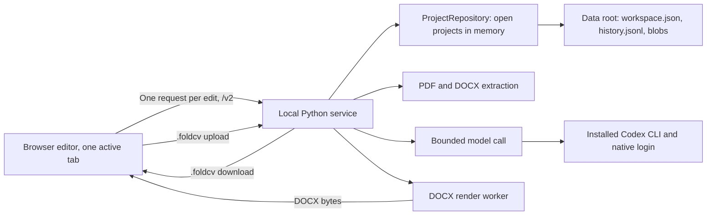

# Resume editor architecture

> D082/D083 import path: fixed left resume history, explicit new-resume processing,
> advisory model assessment, then fact extraction and the original text in the
> editor. No initial prose rewrite. Settings use a separate screen with left
> section navigation.

> D039: MVP exports DOCX only through the existing Python writer. PDF export and
> paginated preview are deferred; the new flow must work without LibreOffice.
> Portable project save/open and PDF source import remain supported.

> Storage and transport follow D109; see [Storage and transport](#storage-and-transport).
> Later sections that conflict with it describe the first-release design; D109 wins.

## Runtime boundaries

Use React and TypeScript for the browser interface, a Python FastAPI service for
document work and CLI subprocesses, and shared versioned JSON contracts. Serve the
production frontend from the local service so the default installation has one
origin and one launcher. Vite is a development build tool, not a production server.

The Python service owns project state. Each open project lives in memory in the
service process and every edit is saved to the local data root before it is
acknowledged. The browser keeps the last reply it adopted and the edits that are
not acknowledged yet. Editor tokens, clipboard captures, task status and assistant
run buffers live only in process memory and are lost at a restart. The installed
CLI owns its credentials; this application does not read or copy them.



Define ports for `Extractor`, `ContentProvider`, `DocumentRenderer`,
`CliRuntime`, and `HostBridge`. The browser must not import Electron APIs,
spawn processes, read arbitrary filesystem paths, or receive provider secrets.
Electron can later implement the host bridge and supervise the same local service.
A remote deployment keeps the data contracts but needs an explicit execution
decision: a protected local companion for the user's CLI, or a different approved
provider adapter. A shared server cannot use a CLI installed on the user's laptop
merely by changing an API URL. Never pool employee subscriptions on that server.

Source layout:

```text
apps/web/src/{workbench,rich,assistant,projects,api,connection,errors,contracts}/
services/api/src/resume_api/{projects,assistant,importer,agent,cli,providers}/
packages/resume_core/{models,extraction,rendering,templates}/ plus project_*, template_*, rich_*, assistant_*
contracts/{json-schema,examples,error-messages.ru.json}
templates/{generic,bundled,foldcv-reference}/   bundled: generic-two-column.yaml, generic-one-column.yaml, shared assets/
tests/  (layout in testing.md)
tools/
```

Python Pydantic models are the contract authority; JSON Schema and TypeScript types
are generated from them ([contracts.md](contracts.md)). The service validates every
request and every reply it builds. The client parses replies with `JSON.parse` and
types them with the generated types; it has no runtime schema validator. Uploaded
`.foldcv` files are checked on the service. Do not maintain independent handwritten
Python and TypeScript schemas.
Build the first frontend from the current wireframe and standard controls. Do not
build a design system, rich text editor or custom PDF viewer. Establish the fake-process test
harness and forbidden provider before feature work; see [testing.md](testing.md).

## Storage and transport

Each open project lives in memory; an edit is one request and one file write; undo
has its own journal (D109). The V1–V6 project generations and the earlier writer
and protocol layers are gone; only version 7 projects open.

### Data root

`storage.data_root()` is `~/Library/Application Support/FoldCV` unless the launcher
passes another root. Tests and `tools/serve_synthetic.py` always use a temporary root.

```text
registry.json                       project list and tombstones (project_store)
catalog.json                        archive flags (project_catalog)
preferences.json, rules.md, assistant-settings.json   settings
template-packages/                  saved template packages, current version per id, default id
projects/<projectId>/workspace.json         the WorkspaceV7 file
projects/<projectId>/history.jsonl          undo journal, local only
projects/<projectId>/{sources,history,template-assets,renders,images}/   content-addressed files
projects/<projectId>/imports/<operation>.json   import operation sidecar while an import runs
assistant/<projectId>/{conversations,runs,proposals}/
```

### Repository

`packages/resume_core/project_repository.py`. `ProjectRepository` keeps one
`ProjectSession` per project for the life of the service: the committed `WorkspaceV7`
object (replaced on each commit, never changed in place), its `projectRevision`, one
reentrant lock, the journal, the editor token, the replay window, the occupied ids
and up to 20 clipboard captures. At most three sessions stay loaded. Eviction unloads
an idle one (workspace and journal); pinned ones (import, export, assistant run) and
locked ones stay. Entering a session's lock loads it again, so every caller works on
the same object, and editor tokens and clipboard captures survive eviction. Read the
workspace, journal and revision only under the lock (or through `repository.read`).
A deletion writes the tombstone under the session lock: a caller waiting for that lock
and any later open get `PROJECT_DELETED`. `start()` runs the D104/D105 history
externalize pass once before any open. Route handlers run repository work in a
worker thread (`asyncio.to_thread`) and never hold a project lock across an `await`.

A commit runs under the session lock. `mutate` serves edits, undo and redo;
`replace` commits a workspace computed outside the lock from a given base revision
(import checkpoints and publication, export records, metadata).

1. A `clientMutationId` in the replay window returns the stored outcome and applies
   nothing; the same id with another request hash is `MUTATION_ID_REUSED`.
2. A base revision other than the current one is `REVISION_CONFLICT` (409 with
   `revision` and `appliedClientMutationIds`).
3. `build(committed)` returns the new workspace; it must not change the committed
   object (checked under `FOLDCV_VERIFY=1`).
4. Fold hooks run (import sidecar, below).
5. One model validation; `updatedAt` is set; `mutationReplay` gets the id and keeps
   the last 200; the size is checked against the D096 setting (`PROJECT_TOO_LARGE`).
6. One serialization (`rich_snapshot_bytes`) and `storage.atomic_write` (temp file,
   fsync, rename, directory fsync). An edit writes nothing else. `replace` writes
   its blobs first: written when missing, checked by hash when present. A workspace
   with loaded import records is decoded back before the file is replaced, so a
   decode failure commits nothing.
7. Memory follows the file.
8. The journal line is appended. A failure there is logged as a journal gap and does
   not fail the request: the committed state is the file.
9. Commit hooks run (sidecar discard, listing heading). A hook failure is logged; the
   commit stands.

A crash leaves the previous or the new `workspace.json`, never a partial one. A retry
after a crash or restart is recognized from `mutationReplay`. An edit costs at most
three fsync calls. `registry.json` is written on create, rename, delete and archive
flags and at close or eviction, not per edit; the listing lays open sessions over it.

### Undo journal

`packages/resume_core/project_journal.py`, file `history.jsonl`. Line kinds: `edit`
(action id, mutation id, revisions, full `before` and `after` payloads of the
undoable keys that changed), `undo`, `redo`, `barrier` and `mark` (a commit without
undoable changes, written only while there is history). Every line names the
revision after it. The keys are those of
`template_local_history.values` (blocks, placements, builtin records, extensions,
relations, issues, scopes, tombstones, coverage anchors, sync rows) plus the order of
the lists those keys do not encode.

- Edits with one `actionId` form one action, so typing is one undo step.
- Undo applies the action's `before`, redo its `after`, both through `mutate`:
  revision-checked, validated, saved and journaled like an edit. An action whose keys
  changed since is refused as `HISTORY_STALE`.
- A `replace` that changes undoable keys (import publication) writes a barrier, which
  clears both stacks. Export records, rename, sources, assets and the template
  package are not on the stack.
- A journal that ends at another revision than `workspace.json` (a line lost in a
  crash) gets a barrier at load instead of undoing around the missing edit. After a
  failed append the next line is preceded by a barrier, so a reload cannot bring the
  cleared actions back.
- Bounds: 200 actions and 16 MiB. A corrupt tail is truncated; the file is compacted
  on load, at close and while open past 800 lines or 32 MiB. The journal is not part
  of `.foldcv`.

### Editor token and one tab

The browser holds one `navigator.locks` lock per profile (`workbench/tab.ts`); a
secondary tab shows the blocking notice (`workbench/BlockedTab.tsx`) and sends no
request. `POST /v2/projects/{id}/open` always issues a fresh editor token and
replaces the previous one; there is no takeover. Writes carry the token. A replaced
token gets `EDITOR_REPLACED` and the page turns read-only with the notice. An unknown
token (service restart) gets `EDITOR_TOKEN_UNKNOWN` and the page reopens. Tokens live
in memory only.

### Edit path

Client: `rich/v7-session.ts` (`TemplateEditorSession`), `v7-translation.ts`,
`save-queue.ts` and `v7-connection.ts`. The queue translates the next intent against
the last adopted response, sends `POST /edits` with `{editorToken, baseRevision,
preparation}` (the preparation carries the `clientMutationId`), adopts the reply's
`response` and maps local block ids through `createdBlocks`. Undo and redo send
`POST /history` with `expectedActionId`, the top of the server's stack.

Server: `projects/editing.py`. Inside `mutate`, `response_for_workspace`
(`projects/service.py`) builds the current response and
`template_preparation.prepare_edit` prepares the authored operation on it;
`validate_preparation` keeps the snapshot and dependency stamp checks.
`EditIdAllocator` derives ids from `[FoldCV authoring v2, project, clientMutationId,
opId]`, so a retry allocates the same ids.

The reply `EditResultV1` has `revision`, `documentRevision`, `clientMutationId`,
`replayed`, `createdIds`, `createdBlocks`, `changedBlockIds`, `history` and the full
`TemplateProjectResponseV1`. The full response per edit replaces D105's slim replies
on purpose: no patches and no client re-verification.

Lost acknowledgment (after `REVISION_CONFLICT`, after `EDITOR_TOKEN_UNKNOWN`, and at
reopen with a pending draft): the client reads the current state; an intent whose id
is in `appliedClientMutationIds` is applied and dropped; an issued one whose base
revision equals the current revision is sent again; an issued one whose document
revision is unchanged (only an export record, a rename or another non-document commit
moved the revision) is translated again and sent with the same id; any other issued
intent's text is shown in a notice and dropped. An unsent intent is never dropped for
its revision: it is translated at its turn, and only a failed translation drops it
with a notice. IndexedDB (`foldcv-pending-edits`) keeps unacknowledged intents with
their mutation id and base revision.

A 4xx refusal other than 408 and 429 stops the queue with its reason. No answer, 408,
429 and 5xx are sent again with the same id after 1, 2, 4, 8 and 16 seconds, then
every 30 seconds. One re-open at a time: requests that lost the token share it. An
undo or redo that cannot be settled is given up with a notice and never blocks input;
a `HISTORY_STALE` reply brings the server's history, which the buttons follow.

Under `FOLDCV_VERIFY=1` the server also decodes the written bytes and compares them
with memory, and rechecks the response snapshot and presentation (`verify_response`).

### Routes

Project routes, under `/v2/projects` (`projects/routes.py`):

| Route | Purpose |
|---|---|
| `GET /v2/projects` | listing |
| `POST /v2/projects/archive` | import a `.foldcv` upload as a new project |
| `POST /{id}/open` | editor token, response, history state, running tasks |
| `GET /{id}` | read without a token |
| `POST /{id}/edits`, `POST /{id}/history` | one edit; undo or redo |
| `POST /{id}/clipboard` | same-project clipboard capture |
| `POST /{id}/check` | the assistant's deterministic check over the committed workspace; read-only, no model call |
| `POST /{id}/rewrite/preview`, `/rewrite/cancel` | rewrite preview of a selection |
| `POST /{id}/import`, `GET /{id}/tasks` | import start, resume or cancel; task status |
| `POST /{id}/export`, `/exports/{attemptId}/retry` | DOCX export |
| `POST /{id}/archive` | `.foldcv` download |
| `POST /{id}/rename`, `/catalog/archive`, `/catalog/restore`, `/restore` | title and archive flags |
| `DELETE /{id}` | delete, body `{"confirmed": true}` |
| `GET /{id}/images/{sha}`, `/sources/{sourceId}/original`, `/original/download` | image and original bytes |

Assistant routes, under `/v2/projects/{id}/assistant` (`assistant/routes.py`):
`/capabilities`, `/conversations` (GET, POST), `/conversations/{cid}/messages`,
`/conversations/{cid}/runs` (POST), `/runs/{rid}/events/{after}` (long poll),
`/runs/{rid}/cancel`, `/proposals`, `/proposals/{pid}`, `/proposals/{pid}/apply`,
`/proposals/{pid}/discard`, `/skills`, `/files/{fileId}` (export links).

Kept `/v1` routes: `POST /v1/session/exchange`; `/v1/settings/*` (rules, connection,
preferences, limits, import model, fallback model, rewrite reasoning, assistant);
`POST /v1/host/*` (CLI discovery, status, models, login, model choice, detach,
install); `GET /v1/rich/template-config` (templates and the default one),
`/v1/rich/template-config/{templateId}` (GET, PUT) with `/check` and `/reset`, and
`PUT /v1/rich/template-default` (Settings template editor); `GET /v1/rich/template-assets/{sha}`;
`GET /v1/rich/template-import` (import availability, templates, default);
`POST /v1/rich/projects/template-input` and `/template-input/{templateId}` (the upload that
creates a V7 pre-draft with the default or the chosen template; an unknown template answers 404 before the upload is
parsed); `GET /v1/template-package`. A new template id is one URL path segment (letters, digits, `.`, `_`, `-`); the
compiler refuses other ids, stored packages keep opening. The template routes are in `templates_routes.py`, the others
in `app.py`.

Boundary (`app.py`): loopback Host and Origin checks; a session cookie from the
one-shot secret exchange (HttpOnly, SameSite=Strict, path `/`); no query strings on
`/v1/` and `/v2/` paths; bounded JSON bodies; `Cache-Control: no-store` on project
replies. Errors are `{"error": {"code", "retryable", "stage"}}`; every code has a
Russian text in `contracts/error-messages.ru.json`.

### Tasks, import, export, rewrite

`packages/resume_core/project_tasks.py` keeps an in-memory `TaskRegistry` of `{id,
projectId, kind, state, stage, startedAt, elapsed, detail, error}` for import, export
and rewrite, one running task per project and kind. `GET /tasks` feeds the import
activity view (stage, elapsed time, saved discoveries, and `detail.progress` from
`projects/import_progress.py`: steps, recent model calls, the last event times and the
stall check). Nothing there is durable.

- Imports of several projects run at once, beside rewrites and assistant turns on either
  provider (D121): each holds a shared inference permit. Only a sign-in, CLI install or
  connection check holds the exclusive one; an import started then waits with stage
  `queued` and its start reply returns at once. The client
  (`workbench/import/tracker.ts`) follows each project's task without blocking the
  workspace. A run is stalled when no event arrives for longer than the longest model
  call (180 s) plus cleanup and 60 s, or when it outlives its captured time limits.
- The import start may carry `effort`; the capture checks it against the import model's
  catalog efforts (`IMPORT_EFFORT_UNSUPPORTED`) and records it.

- Import (`projects/intake.py`, `projects/imports.py`, `importer/template_pipeline.py`):
  the upload becomes a V7 pre-draft through `repository.create`; the import runs as a
  task that holds one shared inference permit. The start answers 202 at once; an import
  queued behind a sign-in or connection check shows stage `waiting`, and the
  client counts its time limit from the end of that wait. Checkpoints and publication
  are `repository.replace` with the revision of the snapshot the pipeline computed
  from; on `REVISION_CONFLICT` the pipeline re-bases or fails the task. The
  publication commit is the point of no return: a cancel before it leaves the import
  unpublished and resumable, a cancel after it leaves the task succeeded. A resume
  renews a saved finalization of an earlier authorization; nothing was published with
  it, so the renewal takes the current content (a formatting date changed meanwhile).
  Cancel only asks the import to stop; the runner finishes its own task
  after it released its permit and pin. Shutdown, sign-out and a sign-in change stop
  running imports (15 s bound).
- Deletion (`ProjectService.delete`): no task of the project starts meanwhile; its
  imports, exports and rewrite are cancelled and awaited for up to 15 s (else 409
  `REQUEST_IN_PROGRESS`); a permit its stopped import kept is released.
- Operation sidecar (`importer/template_sidecar.py`, `projects/fold.py`): each
  processing step replaces `imports/<operation>.json` atomically, bound to the
  project revision it extends. A fold hook folds a sidecar at the current revision
  into any commit (an edit at that revision keeps its document and takes the
  sidecar's operation and facts) and removes the file after the write. A sidecar at
  an older revision fences the import. After a crash, `import` with `kind: resume`
  continues from the sidecar.
- Export (`projects/exports.py`): renders DOCX through the render worker
  (`rendering.TemplateDocxRenderer`) and records the attempt, capture and artifact
  with one `replace` on the current workspace that changes no undoable key, so edits
  made during the render stay and the attempt keeps the snapshot it rendered. Reply headers name the attempt,
  the artifact hash and the rendered snapshot; the client checks the snapshot
  (`contracts/template-export.ts`).
- Rewrite preview (`projects/rewrite.py`, `template_rewrite.py`): one model call and
  no project write; Apply is an ordinary edit.
- Clipboard (`projects/clipboard.py`): captures stay in the session (20 at most), are
  checked against their witnesses at paste and are lost at a restart.
- Files (`projects/sources.py`, `projects/images.py`, `projects/blobs.py`): reads
  only private, owned files with size and hash checks; unreferenced images are
  removed at session close.
- Archive (`projects/archive.py`, `template_archive.py`): the `.foldcv` V7 format is
  unchanged; the journal is not included.

### Assistant

Runtime: the pinned Codex app-server subprocess (`agent/runtime.py`), the in-process
MCP listener with a bearer token (`agent/mcp.py`), the public page fetcher
(`agent/web.py`) and the bundled skills (`assistant/skills/`).

- Runs (`assistant/runs.py`): one run per project; the project stays editable. A run
  pins the committed workspace object at its start and every read serves that object
  (`assistant/context.py`). Events go to a ring buffer and `runs/<id>.jsonl`; Stop
  cancels the run. `allowWeb` and `allowEdits` are captured at run start.
- Tools (`assistant/tools.py`, ten): `read_resume`, `find_text`, `read_facts`,
  `read_original`, `read_skill`, `check_resume`, `read_public_page`,
  `export_document`, `propose_changes`, `publish_findings`. Only the last two store
  anything, and neither writes the project. A tool reply is checked against the size
  limits before anything is stored, so a stored proposal always reaches the model as
  a success. A conversation file is trimmed by size (oldest turns first) as well as
  by count. Run files (event lines, the run state, the answer, sources, findings and
  proposals) are written on one writer thread, in order and never on the event loop;
  the terminal event shows once its line is on disk and the run's control is gone.
- Proposals (`assistant_store.py`, `assistant_compiler.py`, `assistant/proposals.py`):
  a proposal file holds the ops, the preview and the hash of each touched block or
  record in the pinned workspace. Only the user applies it (D093). Apply runs inside
  one `repository.mutate`: a changed hash gives `ASSISTANT_PROPOSAL_STALE` with the
  targets; otherwise the ops compile to `AuthoredOperation` values through
  `prepare_edit` against the current workspace and commit with the proposal id as
  action id, so one Undo reverts the whole proposal. Apply carries the panel's
  current `allowEdits` and is refused when it is off (`ASSISTANT_EDITS_OFF`). A
  history proposal carries `expectedActionId`; project actions call the same service
  functions as the UI.
- Client: `assistant/api.ts`, `controller.ts` (one long-poll loop per run),
  `Drawer.tsx`, `proposal.tsx`. Apply goes through
  `TemplateEditorSession.applyAssistant` and adopts the `EditResultV1`.

## Frontend controls and appearance

React, TypeScript, Radix Primitives, and Tailwind are confirmed. Use standard HTML
controls for simple fields and buttons, and Radix for dialogs, menus, and tabs.
Radix handles interaction behavior; Tailwind and shared theme values define the
appearance. Keep components small and extract repeated controls and variants.

Define shared CSS variables for backgrounds, text, borders, accents, and status
colors, and map them to semantic Tailwind utilities such as `bg-surface`,
`text-content`, `border-outline`, and `text-danger`. Keep light and dark values
in one place and apply them across native controls and Radix components. Use
complete utility names or explicit variant maps so Tailwind can detect them.

Support light, dark, and system modes. Default to system, follow OS theme changes
in that mode, and persist a manual choice as an application preference. Apply the
resolved theme before the first UI paint.

## State management decisions

Do not use Redux or Redux Toolkit. Consider XState for specific workflows when
statecharts simplify transitions and testing. It is optional, not a current
dependency or required global store.

Keep the planned pure action/reducer project model. Native React bindings versus
Zustand remains undecided; no project store library is confirmed.

## TypeScript safety

All project-owned TypeScript, including tests and generated contracts, must use
`strict`, `noUncheckedIndexedAccess`, `exactOptionalPropertyTypes`,
`noImplicitOverride`, and `noFallthroughCasesInSwitch`. Do not disable individual
strict checks. Explicit and implicit `any` are forbidden. Treat external data as
`unknown` until it is checked. Replies of the local service are the exception: the
service validated them, so the client parses them with `JSON.parse` and types them
with the generated contracts.

Do not declare `enum` or `const enum`. Use literal unions or `as const` objects;
configure generated contracts to emit unions too. Do not bypass checks with
suppression comments, double assertions, or lint disables.

At frontend setup, require `tsc --noEmit` and type-aware ESLint in local checks
and CI. Lint must reject explicit `any`, unsafe use of untyped values, and
`TSEnumDeclaration` nodes. Exact rules are in
[the frontend standards](../../.cursor/rules/frontend-standards.mdc).
TypeScript strict mode covers implicit `any`; explicit `any` needs a lint rule.
[typescript-eslint documentation](https://typescript-eslint.io/rules/no-explicit-any/)

## Pipeline and request economy

1. Extract text and structural locations locally, without a model. Preserve
   originals and extraction diagnostics. DOCX paragraphs, tables, headers and
   footers need stable locations; never assume page numbers exist in DOCX.
2. Extract literal fields, date candidates, known aliases and source IDs in code.
   Interpret ambiguous prose and project associations with one bounded CLI text
   operation. Return candidate facts and references. Code merges these with exact
   source fields; the model cannot alter originals or confidently parsed literals.
3. Compute dates, overlap unions, old-career groups, technology aliases, candidate
   focus choices, and validation issues in code.
4. Draft only the profile and project prose with one content operation using
   normalized facts and template content rules. Education, contacts, dated titles,
   focus, technology groups and the old-career list are assembled by code. Do not
   send the original file, complete source text,
   font data, logo data, HTML, or earlier conversation history again.
5. Validate the proposed blocks against facts, compute coverage, and show them.
   Human review handles disputed meaning. No automatic reviewer, self-critique,
   memory summary, or title-generation model call is added.
6. Render documents locally. A rewrite later includes only the selected block,
   its facts, directly linked excerpts when needed, requested style, and locks.

Two logical content operations are a normal-case target. A CLI can retry or make
several internal inference requests; do not claim one process equals one request.
Measure reported usage, fixed harness overhead, and internal attempts when exposed.
Skip semantic normalization for a validated reopened project; skip generation for
unchanged or explicitly verbatim prose. Source and artifact filenames use code.
Preflight token estimates and configured page/text limits. Large inputs require
an explicit bounded chunk plan with visible estimated calls; do not silently
truncate. Split on document structure, preserve overlap references, deduplicate
facts by IDs and evidence, and review employment boundaries. Chunk support is a
follow-up; first release rejects oversized work with source/archive export intact.

Compile compact runtime prompts from the skill rules. Configure and test a CLI
profile without shell, browser, filesystem exploration, MCP, plugins, hooks,
personal memory, skill discovery or delegation. A prompt asking for no tools is
not enforcement; read-only sandboxing alone still permits reads and tool loops.
Prove the restricted profile in T00B before sending real resumes. Keep model
responses task-specific and schema-constrained. Archive bookkeeping, evidence,
duration labels and all other deterministic work run in code.

## Canonical project contract

> First-release contract design (`models/contracts.py`, `schemaVersion: 3`). Stored
> projects are `WorkspaceV7` (`models/template_workspace.py`); see [Storage and transport](#storage-and-transport).

Use a new project schema version, distinct from the current version 2 experiment.
Migrate old archives explicitly; never reinterpret them as complete atomic facts.

`Project` contains:

- `schemaVersion`, random `projectId`, `revision`, frozen `asOf`, `createdAt`.
- `sources`: file ID, original name/MIME, byte hash, original-byte reference,
  parser/version, ordered source units, warnings, and correction overlays.
- `facts`: stable fact IDs, revision, kind, typed value, evidence, importance,
  origin, and any job/project association.
- `employment`: employers, roles, dated periods, subprojects, and fact IDs.
- `views`: block IDs and order, selected facts, text, locks, exclusions, and rules.
- `templates`: exact package/version/hash and assets required to reproduce output.
- `review`: issues, decisions, fact dispositions, acknowledgments and revisions.
- `operations`: request metadata, usage, statuses, proposed changes, and local undo.
- `renders`: snapshot hashes, renderer versions, artifact hashes, optional bytes.

Keep original files and large assets outside JSON inside the project ZIP; use
references to manifest entries. Do not base64-copy them into every API request.

### Source and fact example

```json
{
  "id": "fact_team_01",
  "revision": 1,
  "kind": "leadership",
  "jobId": "job_recent",
  "value": {
    "action": "built_and_led_team",
    "from": 0,
    "to": 5,
    "unit": "engineers",
    "attribution": "personal"
  },
  "evidence": [{"sourceId": "src_01", "unitId": "u_21"}],
  "importance": "essential",
  "origin": "source"
}
```

Numeric facts should retain value or range, comparison operator, units, period,
baseline, result, scope, attribution, and qualifiers. Do not reduce "up to 2000
per day" to the unordered token `2000`. Generic text facts are still needed;
use a small set of typed kinds rather than an ontology project.

Source units preserve extraction text exactly. Facts normalize meaning and point
back to units. User corrections are overlays with their own origin and revision.
An added fact uses `origin: user`, not fabricated source references. Changing
extraction or parsing creates a new source revision; old references remain intact.

### View block example

```json
{
  "id": "profile",
  "kind": "profile",
  "revision": 4,
  "text": "Backend developer focused on recent payment integrations.",
  "factIds": ["fact_domain_01", "fact_integration_02"],
  "factRevisions": {"fact_domain_01": 1, "fact_integration_02": 2},
  "origin": "manual",
  "locked": true,
  "status": "ready",
  "contentPolicyVersion": "editorial-1"
}
```

Block status is one of `empty`, `running`, `proposed`, `ready`, `stale`, or `error`.
Visibility is separate from status. An operation has `queued`, `running`,
`completed`, `failed`, `cancelled`, or `interrupted`. Keep the accepted text while
a proposal is running; do not overload one status with both states.

### Dependencies and patch rules

Track dependency hashes over selected fact revisions, content policy, language,
and template rules. A layout-only template change invalidates renders; a rule
change can invalidate selected blocks. A fact correction invalidates dependent
prose and derived experience. Unrelated blocks keep their revisions and locks.

A proposal includes `operationId`, `blockId`, `baseBlockRevision`,
`dependencyHash`, replacement content, evidence, and validation findings. Accept
it only if the base revision and dependencies still match. Replace an allowlisted
block payload; do not execute arbitrary JSON Patch paths returned by a model.

Maintain one previous accepted revision per block for first-release undo, including
text, lock, provenance and review state. Preserve it in explicit project exports;
retain current review decisions. Do not retain arbitrary model conversation
transcripts. Derived values are reproducible and can be recomputed from facts.

## Application API

The routes are listed under [Storage and transport](#routes). Rules for all of them:

- Inputs are validated before work. Bodies are JSON, except the two uploads
  (`POST /v1/rich/projects/template-input`, `POST /v2/projects/archive`).
- Use opaque ids. No candidate names in URLs, logs, temporary directory names or
  error text. API paths take no query strings; a cursor is a path segment.
- Replies with project data carry `Cache-Control: no-store`.
- Long work is a task (import, export, rewrite) polled through `GET /tasks`, or an
  assistant run whose events the client long-polls. Do not invent provider progress
  percentages. A model result is parsed and validated whole before anything is
  saved; partial text is never applied.
- Cancellation stops local work and closes the upstream request best effort;
  consumed inference may still count. Do not promise exactly-once charging.
- Host connection routes (`/v1/host/*`) expose typed options, never command
  strings. Detach must not run a global CLI logout.
- Errors carry a public code, `retryable` and `stage`, never raw prompts or upstream
  response bodies. Every code has a Russian text in `contracts/error-messages.ru.json`;
  `tests/settings/test_error_messages.py` checks the coverage.

## CLI adapter and usage controls

Expose one internal operation: `generate(schema, input, policy, cancellation)`.
Implement `CodexCliProvider` and a fake provider first. The adapter returns validated
JSON, reported token usage, CLI/model versions, elapsed time, logical attempts,
nullable internal inference count and plan-limit metadata. Serialize CLI generation
initially. Each request has a fresh ephemeral session and a bounded lifetime.

Use T3 Code's dedicated text-generation path as the reference: `codex exec`, prompt
over stdin, `--ephemeral`, JSON Schema, validated final output, timeout and cleanup.
Add JSON event handling for usage and cancellation. Its full persistent coding
thread driver is not needed for these bounded operations. Keep Python as the
service runtime; adapt the subprocess protocol rather than importing T3's complete
TypeScript/Effect server.

Check executable version, structured output, ephemeral behavior, native login
mode, and restricted configuration before declaring the provider ready. Use
`codex login status` or a short-lived app-server handshake with `account/read` and
`model/list`; a model catalog is not proof of inference entitlement. Capability
checks must not generate text. A synthetic inference check is explicit, never
an idle health probe. Never read `auth.json`, emulate a ChatGPT web session, or
pass around extracted subscription tokens. Native login and refresh stay in CLI.

Resolve actual models and options from the installed CLI/account. Start evaluation
with Luna if available and permitted; never silently replace it with Astra or a
paid API model. Configure input-size ceilings, timeout, bounded output buffers and
one total application retry/repair allowance. Tune CLI retries where documented;
record any uncontrollable internal retry behavior. Do not invent a hard token cap
or promise unlimited subscription usage. Keep request attempts and token usage
separate; missing quota/price/usage data is unknown, not zero.

Keep user input out of process arguments, shell commands, logs and filenames.
Use an argv array and a clean operation working directory. Disable inherited
tools/hooks/instructions with a supported, tested configuration; do not modify
the user's global settings. Strip unrelated API keys and runtime overrides from
the child environment so subscription mode cannot silently select another route.
Avoid sending contacts when the text operation does not need them; remaining
career details are still personal data.

Accepted model results are stored in the project on the service: import records
in the project's `history/` files, applied text in `workspace.json`. A rewrite
preview is not stored; Apply saves it as an ordinary edit. Reuse deterministic
results freely. A deliberate rewrite requests a new preview. Never persist raw CLI
transcripts for replay.

## Subscription and deployment boundaries

The selected first-release flow is native CLI authentication, not an OAuth client
implemented by this application. Each operator installs/signs into the supported
CLI using their own eligible subscription. Official Codex documentation describes
subscription sign-in and non-interactive execution; T3 documents reuse of an
existing CLI login. These establish the technical integration, not a universal
permission to reuse any provider's subscription in any product.
[Codex authentication](https://learn.chatgpt.com/docs/auth),
[non-interactive execution](https://learn.chatgpt.com/docs/non-interactive-mode),
[T3 CLI login](https://github.com/pingdotgg/t3code/blob/98beed1a226c42b85c52ff5ee9d5dbb67d776a77/docs/user/providers-codex.md)

The T3 code license covers software reuse, not OpenAI plan entitlements. Respect
the account's limits and organization policies. No account pooling, quota-avoidance
rotation, token extraction, general API resale, or claims that installing a CLI
creates an API entitlement. Before adding another CLI, review that provider's
current terms and supported automation flow separately.

Direct Sign in with ChatGPT and OpenRouter adapters are deferred. Revisit them
only if a later deployment or measured capability gap requires them. Google and
open-weight model comparisons remain future provider work; a Codex subscription
does not grant their usage. Do not implement a silent API fallback in this release.

Ephemeral CLI sessions do not establish remote zero retention. The CLI sends text
to the account's provider, under that account's applicable data settings. Keep
this separate from what the application stores locally.

## DOCX and PDF rendering

The authoritative chain is `RenderSnapshot → DOCX → PDF`. Use a trusted DOCX base,
python-docx for structured elements and styles, and narrowly scoped docxtpl tags
if useful. Preserve editability: paragraphs, runs, lists, cells, and inline images;
never render whole pages as images in a Word container.
[python-docx styles](https://python-docx.readthedocs.io/en/stable/user/styles-using.html),
[docxtpl features](https://docxtpl.readthedocs.io/en/stable/)

Start with a technical spike reproducing the two-column reference: page size,
margins, source fonts, sidebar, logo, focus icons, gray bars, footer, and pagination.
Test multi-page tables, long names, long education, empty fields, and many projects.
Use flowing editable elements and avoid absolute-position text boxes where possible.
Do not sacrifice editability or shrink text to force a preset page count.

Convert the generated DOCX with a pinned LibreOffice build and controlled fonts.
Run conversion in a unique operation directory with an isolated user profile,
no macros, no external links, a timeout, and process-tree cleanup. Its documented
CLI supports headless conversion and a separate user profile.
[LibreOffice parameters](https://help.libreoffice.org/latest/en-US/text/shared/guide/start_parameters.html)

Export renders the snapshot the editor sends (`TemplateSnapshotIdentity`) through
the render worker; typing never renders. The reply names the snapshot it rendered
and the client refuses a different one. The project records one completed attempt
with the artifact hash; a retry reuses the attempt id.

PDF is the visual reference. Word and LibreOffice can paginate DOCX differently;
test both target readers and report any material discrepancy. Do not promise
pixel-identical DOCX display in every editor. The existing ReportLab renderer
remains a regression reference, not a separate production PDF path that drifts
from DOCX. If the DOCX spike cannot meet fidelity, record a concrete alternative
before continuing the renderer-dependent tasks.

## Portable project format

`.foldcv` is a ZIP in the V7 archive format (`template_archive.py`):

```text
manifest.json                 ArchiveManifestV7: path, role, SHA-256 and size of every entry
workspace.json                the WorkspaceV7 file, without render records
<source byteRef>              original source bytes
template/package.json         the captured template package
template/assets/<sha256>      template fonts and icons
template/history/<sha256>     import records
<image path>                  user images the project references
```

Download: `POST /v2/projects/{id}/archive`. Upload: `POST /v2/projects/archive`
creates a new project. The undo journal, renders, credentials, provider secrets,
tokens and filesystem paths are never included.

Open an archive only after validation (`archive_zip.py`, `open_archive_v7`). Reject
path traversal, symlinks, duplicate entries, excessive expansion, oversized entries
or totals, unknown versions, invalid templates and hash or source mismatches. Hashes
detect corruption, not trusted authorship. Never execute imported code. Only version
7 archives open; there is no migration of older formats.

## Privacy and local service controls

Bind only to loopback by default, validate Host and Origin, use a startup session
secret, and reject unauthenticated local HTTP mutations. Do not accept wildcard
CORS, file paths from browser input, or arbitrary provider base URLs. Configure
any local open-weight endpoint through trusted host settings with an allowlist.

Use per-operation temporary directories and safe filenames. Keep upload size,
page count, archive expansion, parser memory, and conversion time bounded. Content
must not appear in logs, tracing, crash reports, cache keys, telemetry, or URLs.
Log only safe operation metadata. Disable content capture in libraries and proxy
layers. Clear temporary files after operations and reap this app's stale directories
at startup. Test cancellation and killed worker recovery.

For deployment, document reverse-proxy buffering, temporary storage and retention
settings. In-memory application state alone does not establish that infrastructure
never writes to disk. Candidate data must not enter shared caches or backups.

## Reuse of the current experiment

- Reuse editorial rules, fonts/icons, source snapshots, duration union logic and
  synthetic policy tests.
- Refactor `archive.py` file-writing logic into extraction/preservation functions
  that accept bytes and return models. Explicit project saving belongs to the UI.
- Split `check_archive.py` into source-integrity, fact-coverage, view-consistency,
  and document checks. It currently reopens files and verifies whole archives.
- Replace substring-only technology checks with canonical IDs and alias/display
  mappings. Avoid adding awkward duplicate names solely to satisfy a matcher.
- Extend numeric checks to typed metrics, qualifiers and attribution. A number set
  alone cannot detect an inverted result or lost ownership.
- Use `render.py` and current PDFs as visual references. Build an editable DOCX
  path instead of embedding existing PDF pages in DOCX.
- Preserve the CLI wrappers until the new path passes regression checks.

The existing parser uses PyMuPDF. Its published license options are AGPL and
commercial; resolve licensing or use a suitable alternative before distribution.
Keep the extraction interface independent of that choice. This is a dependency
decision, not an assumption that local deployment removes license obligations.
[PyMuPDF licensing](https://pymupdf.io/licensing)
