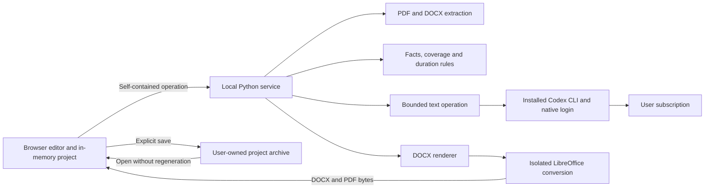

# Resume editor architecture

> D082/D083 import path: fixed left resume history, explicit new-resume processing,
> advisory model assessment, then fact extraction and the original text in the
> editor. No initial prose rewrite. Settings use a separate screen with left
> section navigation. See [the current scope](handoffs/FLOW-UI.md).

> D039: MVP exports DOCX only through the existing Python writer. PDF export and
> paginated preview are deferred; the new flow must work without LibreOffice.
> Portable project save/open and PDF source import remain supported.

> Next iteration: [backend reuse and frontend ownership](flow-recovery-plan.md#backend-reuse-and-frontend-ownership).
> Build the frontend from scratch and reuse/extend Python for canonical project
> state, domain operations, local storage, and export. This supersedes the
> browser-owned state, stateless-project service, and memory-only restrictions
> below. The new plan also overrides conflicting fixed editorial rules and UI
> assumptions. This document retains the previous implementation's architecture.

## Runtime boundaries

Use React and TypeScript for the browser interface, a Python FastAPI service for
document work and CLI subprocesses, and shared versioned JSON contracts. Serve the
production frontend from the local service so the default installation has one
origin and one launcher. Vite is a development build tool, not a production server.

The browser owns project state. The service receives self-contained operations
and returns data or bytes; it has no project database, session history, durable
job queue, or upload registry. Process-level state may contain active requests,
CLI process handles and public template assets, but not completed projects. The
installed CLI owns its credentials; this application does not read or copy them.



Define ports for `Extractor`, `ContentProvider`, `DocumentRenderer`,
`CliRuntime`, and `HostBridge`. The browser must not import Electron APIs,
spawn processes, read arbitrary filesystem paths, or receive provider secrets.
Electron can later implement the host bridge and supervise the same local service.
A remote deployment keeps the data contracts but needs an explicit execution
decision: a protected local companion for the user's CLI, or a different approved
provider adapter. A shared server cannot use a CLI installed on the user's laptop
merely by changing an API URL. Never pool employee subscriptions on that server.

Suggested source layout:

```text
apps/web/src/{project,editor,evidence,preview,operations,export,settings}/
services/api/src/resume_api/{routes,providers,cli,workers}/
packages/resume_core/{models,extraction,policy,validation,rendering,migrations}/
contracts/{json-schema,examples}/
templates/generic/{manifest.json,base.docx,assets}/
prompts/{normalize,draft,rewrite}/
tests/{contracts,unit,property,integration,e2e,render,privacy,fixtures/synthetic}/
evals/{synthetic,private-manifest}/
```

Use Python Pydantic models as the contract authority, export JSON Schema, and
generate TypeScript types. Validate imported files and responses at runtime too.
Do not maintain independent handwritten Python and TypeScript schemas.
Build the first frontend from the current wireframe and standard controls. Do not
build a design system, rich text editor or custom PDF viewer. Establish the fake-process test
harness and forbidden provider before feature work; see [testing.md](testing.md).

## Frontend controls and appearance

React, TypeScript, Radix Primitives, and Tailwind are confirmed. Use standard HTML
controls for simple fields and buttons, and Radix for dialogs, menus, and tabs.
Radix handles interaction behavior; Tailwind and shared theme values define the
appearance. Keep components small and extract repeated controls and variants.

Define shared CSS variables for backgrounds, text, borders, accents, and status
colors, and map them to semantic Tailwind utilities such as `bg-surface`,
`text-content`, `border-outline`, and `text-danger`. Keep light and dark values
in one place and apply them across native controls and Radix components. Use
complete utility names or explicit variant maps so Tailwind can detect them.

Support light, dark, and system modes. Default to system, follow OS theme changes
in that mode, and persist a manual choice as an application preference. Apply the
resolved theme before the first UI paint.

## State management decisions

Do not use Redux or Redux Toolkit. Consider XState for specific workflows when
statecharts simplify transitions and testing. It is optional, not a current
dependency or required global store.

Keep the planned pure action/reducer project model. Native React bindings versus
Zustand remains undecided; no project store library is confirmed.

## TypeScript safety

All project-owned TypeScript, including tests and generated contracts, must use
`strict`, `noUncheckedIndexedAccess`, `exactOptionalPropertyTypes`,
`noImplicitOverride`, and `noFallthroughCasesInSwitch`. Do not disable individual
strict checks. Explicit and implicit `any` are forbidden. Treat external data as
`unknown` until runtime validation establishes its type.

Do not declare `enum` or `const enum`. Use literal unions or `as const` objects;
configure generated contracts to emit unions too. Do not bypass checks with
suppression comments, double assertions, or lint disables.

At frontend setup, require `tsc --noEmit` and type-aware ESLint in local checks
and CI. Lint must reject explicit `any`, unsafe use of untyped values, and
`TSEnumDeclaration` nodes. Exact rules are in
[the frontend standards](../../.cursor/rules/frontend-standards.mdc).
TypeScript strict mode covers implicit `any`; explicit `any` needs a lint rule.
[typescript-eslint documentation](https://typescript-eslint.io/rules/no-explicit-any/)

## Pipeline and request economy

1. Extract text and structural locations locally, without a model. Preserve
   originals and extraction diagnostics. DOCX paragraphs, tables, headers and
   footers need stable locations; never assume page numbers exist in DOCX.
2. Extract literal fields, date candidates, known aliases and source IDs in code.
   Interpret ambiguous prose and project associations with one bounded CLI text
   operation. Return candidate facts and references. Code merges these with exact
   source fields; the model cannot alter originals or confidently parsed literals.
3. Compute dates, overlap unions, old-career groups, technology aliases, candidate
   focus choices, and validation issues in code.
4. Draft only the profile and project prose with one content operation using
   normalized facts and template content rules. Education, contacts, dated titles,
   focus, technology groups and the old-career list are assembled by code. Do not
   send the original file, complete source text,
   font data, logo data, HTML, or earlier conversation history again.
5. Validate the proposed blocks against facts, compute coverage, and show them.
   Human review handles disputed meaning. No automatic reviewer, self-critique,
   memory summary, or title-generation model call is added.
6. Render documents locally. A rewrite later includes only the selected block,
   its facts, directly linked excerpts when needed, requested style, and locks.

Two logical content operations are a normal-case target. A CLI can retry or make
several internal inference requests; do not claim one process equals one request.
Measure reported usage, fixed harness overhead, and internal attempts when exposed.
Skip semantic normalization for a validated reopened project; skip generation for
unchanged or explicitly verbatim prose. Source and artifact filenames use code.
Preflight token estimates and configured page/text limits. Large inputs require
an explicit bounded chunk plan with visible estimated calls; do not silently
truncate. Split on document structure, preserve overlap references, deduplicate
facts by IDs and evidence, and review employment boundaries. Chunk support is a
follow-up; first release rejects oversized work with source/archive export intact.

Compile compact runtime prompts from the skill rules. Configure and test a CLI
profile without shell, browser, filesystem exploration, MCP, plugins, hooks,
personal memory, skill discovery or delegation. A prompt asking for no tools is
not enforcement; read-only sandboxing alone still permits reads and tool loops.
Prove the restricted profile in T00B before sending real resumes. Keep model
responses task-specific and schema-constrained. Archive bookkeeping, evidence,
duration labels and all other deterministic work follow
[the execution policy](execution-policy.md).

## Canonical project contract

Use a new project schema version, distinct from the current version 2 experiment.
Migrate old archives explicitly; never reinterpret them as complete atomic facts.

`Project` contains:

- `schemaVersion`, random `projectId`, `revision`, frozen `asOf`, `createdAt`.
- `sources`: file ID, original name/MIME, byte hash, original-byte reference,
  parser/version, ordered source units, warnings, and correction overlays.
- `facts`: stable fact IDs, revision, kind, typed value, evidence, importance,
  origin, and any job/project association.
- `employment`: employers, roles, dated periods, subprojects, and fact IDs.
- `views`: block IDs and order, selected facts, text, locks, exclusions, and rules.
- `templates`: exact package/version/hash and assets required to reproduce output.
- `review`: issues, decisions, fact dispositions, acknowledgments and revisions.
- `operations`: request metadata, usage, statuses, proposed changes, and local undo.
- `renders`: snapshot hashes, renderer versions, artifact hashes, optional bytes.

Keep original files and large assets outside JSON inside the project ZIP; use
references to manifest entries. Do not base64-copy them into every API request.

### Source and fact example

```json
{
  "id": "fact_team_01",
  "revision": 1,
  "kind": "leadership",
  "jobId": "job_recent",
  "value": {
    "action": "built_and_led_team",
    "from": 0,
    "to": 5,
    "unit": "engineers",
    "attribution": "personal"
  },
  "evidence": [{"sourceId": "src_01", "unitId": "u_21"}],
  "importance": "essential",
  "origin": "source"
}
```

Numeric facts should retain value or range, comparison operator, units, period,
baseline, result, scope, attribution, and qualifiers. Do not reduce "up to 2000
per day" to the unordered token `2000`. Generic text facts are still needed;
use a small set of typed kinds rather than an ontology project.

Source units preserve extraction text exactly. Facts normalize meaning and point
back to units. User corrections are overlays with their own origin and revision.
An added fact uses `origin: user`, not fabricated source references. Changing
extraction or parsing creates a new source revision; old references remain intact.

### View block example

```json
{
  "id": "profile",
  "kind": "profile",
  "revision": 4,
  "text": "Backend developer focused on recent payment integrations.",
  "factIds": ["fact_domain_01", "fact_integration_02"],
  "factRevisions": {"fact_domain_01": 1, "fact_integration_02": 2},
  "origin": "manual",
  "locked": true,
  "status": "ready",
  "contentPolicyVersion": "editorial-1"
}
```

Block status is one of `empty`, `running`, `proposed`, `ready`, `stale`, or `error`.
Visibility is separate from status. An operation has `queued`, `running`,
`completed`, `failed`, `cancelled`, or `interrupted`. Keep the accepted text while
a proposal is running; do not overload one status with both states.

### Dependencies and patch rules

Track dependency hashes over selected fact revisions, content policy, language,
and template rules. A layout-only template change invalidates renders; a rule
change can invalidate selected blocks. A fact correction invalidates dependent
prose and derived experience. Unrelated blocks keep their revisions and locks.

A proposal includes `operationId`, `blockId`, `baseBlockRevision`,
`dependencyHash`, replacement content, evidence, and validation findings. Accept
it only if the base revision and dependencies still match. Replace an allowlisted
block payload; do not execute arbitrary JSON Patch paths returned by a model.

Maintain one previous accepted revision per block for first-release undo, including
text, lock, provenance and review state. Preserve it in explicit project exports;
retain current review decisions. Do not retain arbitrary model conversation
transcripts. Derived values are reproducible and can be recomputed from facts.

## Application API

All candidate-bearing routes are POST, with `Cache-Control: no-store`. Inputs are
validated before work. Use opaque request IDs; no candidate names in URLs, logs,
temporary directory names, or error text.

- `GET /v1/capabilities`: app/schema versions, ready renderers, supported formats,
  public templates, configured limits, provider capability summaries.
- `POST /v1/extract`: multipart file; returns source units, locations, extraction
  diagnostics and hash. No durable file ID that must later be fetched.
- `POST /v1/normalize`: source units and explicit options; returns canonical facts
  and unresolved items. Does not rewrite original units.
- `POST /v1/draft`: selected facts and template content rules; returns a complete
  proposed view. No free-form document bytes from the model.
- `POST /v1/rewrite`: one block snapshot, dependency facts, instruction and budgets;
  returns a proposed replacement with the base revision.
- `POST /v1/validate`: facts, view and policy; returns issues and coverage. Full
  archive integrity is checked locally on import/export, not by resending source
  PDFs on each keystroke.
- `POST /v1/render`: immutable render snapshot and exact template assets/version;
  returns a bounded ZIP of `resume.docx`, `resume.pdf`, and `render.json` metadata.
  The browser unpacks it into memory. No server-side download handles.
- Local host-only connection routes: discover/validate the executable, inspect
  native login status, start the CLI's sign-in on explicit request, detach the
  runtime, and list reported models/limits. Expose typed options, never arbitrary
  command strings. Detach must not run a global CLI logout.

Normalize, draft, and rewrite use a streaming POST response consumed with `fetch`
and `AbortController`. Do not use GET EventSource with resume data in query strings.
FastAPI provides streaming responses; use its documented response primitives.
[FastAPI response documentation](https://fastapi.tiangolo.com/advanced/custom-response/)

Each application event is a complete envelope:

```json
{
  "requestId": "op_123",
  "sequence": 3,
  "type": "operation.completed",
  "baseRevision": 12,
  "payload": {"result": {}, "usage": {"inputTokens": 1500, "outputTokens": 500}}
}
```

Events include `operation.started`, `stage.changed`, `result.ready`,
`usage.updated`, `operation.completed`, and `operation.failed`. Do not invent
provider progress percentages. Parse and validate the entire structured result
before publishing accepted facts or replacements in version 1. Streaming text
can be shown as provisional activity, never applied as incomplete JSON.

There is no durable reconnect/resume endpoint. On disconnect mark the operation
interrupted, keep accepted work, and offer explicit retry. A `requestId` dedupes
responses inside the live tab, not provider billing across restarts. Cancellation
stops local application and closes the upstream request best-effort; already
consumed inference may still count. Do not promise exactly-once charging.

Standard error codes include `UNSUPPORTED_INPUT`, `EXTRACTION_INCOMPLETE`,
`INPUT_TOO_LARGE`, `AUTH_REQUIRED`, `PLAN_NOT_ELIGIBLE`, `RATE_LIMITED`,
`CLI_MISSING`, `CLI_UNSUPPORTED`, `CLI_PROFILE_UNSAFE`, `AUTH_MODE_MISMATCH`,
`BUDGET_EXCEEDED`, `INVALID_RESULT`, `STALE_PROPOSAL`, `RENDER_UNAVAILABLE`,
`RENDER_FAILED`, `SCHEMA_UNSUPPORTED`, and `ARCHIVE_CORRUPT`. Include retryability
and stage, never raw prompts or upstream response bodies.

## CLI adapter and usage controls

Expose one internal operation: `generate(schema, input, policy, cancellation)`.
Implement `CodexCliProvider` and a fake provider first. The adapter returns validated
JSON, reported token usage, CLI/model versions, elapsed time, logical attempts,
nullable internal inference count and plan-limit metadata. Serialize CLI generation
initially. Each request has a fresh ephemeral session and a bounded lifetime.

Use T3 Code's dedicated text-generation path as the reference: `codex exec`, prompt
over stdin, `--ephemeral`, JSON Schema, validated final output, timeout and cleanup.
Add JSON event handling for usage and cancellation. Its full persistent coding
thread driver is not needed for these bounded operations. Keep Python as the
service runtime; adapt the subprocess protocol rather than importing T3's complete
TypeScript/Effect server. Exact source paths and license notes are in
[cli-integration.md](cli-integration.md).

Check executable version, structured output, ephemeral behavior, native login
mode, and restricted configuration before declaring the provider ready. Use
`codex login status` or a short-lived app-server handshake with `account/read` and
`model/list`; a model catalog is not proof of inference entitlement. Capability
checks must not generate text. A synthetic inference check is explicit, never
an idle health probe. Never read `auth.json`, emulate a ChatGPT web session, or
pass around extracted subscription tokens. Native login and refresh stay in CLI.

Resolve actual models and options from the installed CLI/account. Start evaluation
with Luna if available and permitted; never silently replace it with Astra or a
paid API model. Configure input-size ceilings, timeout, bounded output buffers and
one total application retry/repair allowance. Tune CLI retries where documented;
record any uncontrollable internal retry behavior. Do not invent a hard token cap
or promise unlimited subscription usage. Keep request attempts and token usage
separate; missing quota/price/usage data is unknown, not zero.

Keep user input out of process arguments, shell commands, logs and filenames.
Use an argv array and a clean operation working directory. Disable inherited
tools/hooks/instructions with a supported, tested configuration; do not modify
the user's global settings. Strip unrelated API keys and runtime overrides from
the child environment so subscription mode cannot silently select another route.
Avoid sending contacts when the text operation does not need them; remaining
career details are still personal data.

Cache accepted results in the current browser project only, keyed by fact
revisions, prompt version, model settings and schema. Export them only through
the explicit project save. Reuse deterministic results freely. A deliberate
rewrite requests a new proposal. Never persist raw CLI transcripts for replay.

## Subscription and deployment boundaries

The selected first-release flow is native CLI authentication, not an OAuth client
implemented by this application. Each operator installs/signs into the supported
CLI using their own eligible subscription. Official Codex documentation describes
subscription sign-in and non-interactive execution; T3 documents reuse of an
existing CLI login. These establish the technical integration, not a universal
permission to reuse any provider's subscription in any product.
[Codex authentication](https://learn.chatgpt.com/docs/auth),
[non-interactive execution](https://learn.chatgpt.com/docs/non-interactive-mode),
[T3 CLI login](https://github.com/pingdotgg/t3code/blob/98beed1a226c42b85c52ff5ee9d5dbb67d776a77/docs/user/providers-codex.md)

The T3 code license covers software reuse, not OpenAI plan entitlements. Respect
the account's limits and organization policies. No account pooling, quota-avoidance
rotation, token extraction, general API resale, or claims that installing a CLI
creates an API entitlement. Before adding another CLI, review that provider's
current terms and supported automation flow separately.

Direct Sign in with ChatGPT and OpenRouter adapters are deferred. Revisit them
only if a later deployment or measured capability gap requires them. Google and
open-weight model comparisons remain future provider work; a Codex subscription
does not grant their usage. Do not implement a silent API fallback in this release.

Ephemeral CLI sessions do not establish remote zero retention. The CLI sends text
to the account's provider, under that account's applicable data settings. Keep
this separate from the application's no-project-storage promise.

## DOCX and PDF rendering

The authoritative chain is `RenderSnapshot → DOCX → PDF`. Use a trusted DOCX base,
python-docx for structured elements and styles, and narrowly scoped docxtpl tags
if useful. Preserve editability: paragraphs, runs, lists, cells, and inline images;
never render whole pages as images in a Word container.
[python-docx styles](https://python-docx.readthedocs.io/en/stable/user/styles-using.html),
[docxtpl features](https://docxtpl.readthedocs.io/en/stable/)

Start with a technical spike reproducing the two-column reference: page size,
margins, source fonts, sidebar, logo, focus icons, gray bars, footer, and pagination.
Test multi-page tables, long names, long education, empty fields, and many projects.
Use flowing editable elements and avoid absolute-position text boxes where possible.
Do not sacrifice editability or shrink text to force a preset page count.

Convert the generated DOCX with a pinned LibreOffice build and controlled fonts.
Run conversion in a unique operation directory with an isolated user profile,
no macros, no external links, a timeout, and process-tree cleanup. Its documented
CLI supports headless conversion and a separate user profile.
[LibreOffice parameters](https://help.libreoffice.org/latest/en-US/text/shared/guide/start_parameters.html)

Cache the latest DOCX/PDF pair in browser memory by snapshot/template/renderer
hash. Render on explicit preview refresh or document export; typing only marks
the current pair stale. Keep at most one active render and one latest requested
snapshot. Discard late results from old revisions. Reuse
the displayed bytes on export; do not rerender them through another engine.

PDF is the visual reference. Word and LibreOffice can paginate DOCX differently;
test both target readers and report any material discrepancy. Do not promise
pixel-identical DOCX display in every editor. The existing ReportLab renderer
remains a regression reference, not a separate production PDF path that drifts
from DOCX. If the DOCX spike cannot meet fidelity, record a concrete alternative
before continuing the renderer-dependent tasks.

## Portable project format

Use `.cvproject` as a ZIP with an explicit schema and entry hashes:

```text
manifest.json
project.json
sources/<source-id>/original.<ext>
sources/<source-id>/extracted.json
templates/<template-id>/<version>/...
renders/<snapshot-id>/resume.docx
renders/<snapshot-id>/resume.pdf
checks.json
```

The manifest records schema version, app/renderer versions, hashes, declared
uncompressed sizes, source metadata, and template versions. Render entries are
optional; original files, extracted units, facts, and accepted edits are not.
No auth credentials, provider secrets, tokens, or unrelated filesystem paths.

Import into a new in-memory project only after validation. Reject path traversal,
symlinks, duplicate entries, excessive expansion ratios, oversized totals, unknown
major versions, unsupported executable templates, and hash mismatches. Hashes
detect corruption, not trusted authorship. Never execute imported code.

Migrate v2 experiment data by preserving originals, units and old view. Mark
unstructured units/facts as needing normalization. Reopening that migrated view
may render without inference, but new fact-aware rewriting requires the explicit
normalization step. Save the migrated project separately from the original.

## Privacy and local service controls

Bind only to loopback by default, validate Host and Origin, use a startup session
secret, and reject unauthenticated local HTTP mutations. Do not accept wildcard
CORS, file paths from browser input, or arbitrary provider base URLs. Configure
any local open-weight endpoint through trusted host settings with an allowlist.

Use per-operation temporary directories and safe filenames. Keep upload size,
page count, archive expansion, parser memory, and conversion time bounded. Content
must not appear in logs, tracing, crash reports, cache keys, telemetry, or URLs.
Log only safe operation metadata. Disable content capture in libraries and proxy
layers. Clear temporary files after operations and reap this app's stale directories
at startup. Test cancellation and killed worker recovery.

For deployment, document reverse-proxy buffering, temporary storage and retention
settings. In-memory application state alone does not establish that infrastructure
never writes to disk. Candidate data must not enter shared caches or backups.

## Reuse of the current experiment

- Reuse editorial rules, fonts/icons, source snapshots, duration union logic and
  synthetic policy tests.
- Refactor `archive.py` file-writing logic into extraction/preservation functions
  that accept bytes and return models. Explicit project saving belongs to the UI.
- Split `check_archive.py` into source-integrity, fact-coverage, view-consistency,
  and document checks. It currently reopens files and verifies whole archives.
- Replace substring-only technology checks with canonical IDs and alias/display
  mappings. Avoid adding awkward duplicate names solely to satisfy a matcher.
- Extend numeric checks to typed metrics, qualifiers and attribution. A number set
  alone cannot detect an inverted result or lost ownership.
- Use `render.py` and current PDFs as visual references. Build an editable DOCX
  path instead of embedding existing PDF pages in DOCX.
- Preserve the CLI wrappers until the new path passes regression checks.

The existing parser uses PyMuPDF. Its published license options are AGPL and
commercial; resolve licensing or use a suitable alternative before distribution.
Keep the extraction interface independent of that choice. This is a dependency
decision, not an assumption that local deployment removes license obligations.
[PyMuPDF licensing](https://pymupdf.io/licensing)
